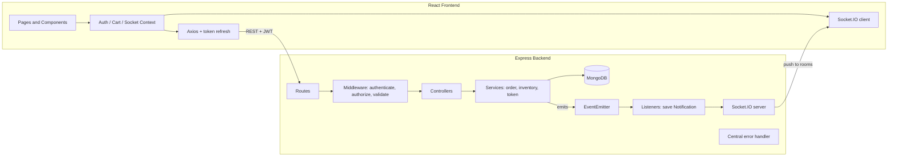
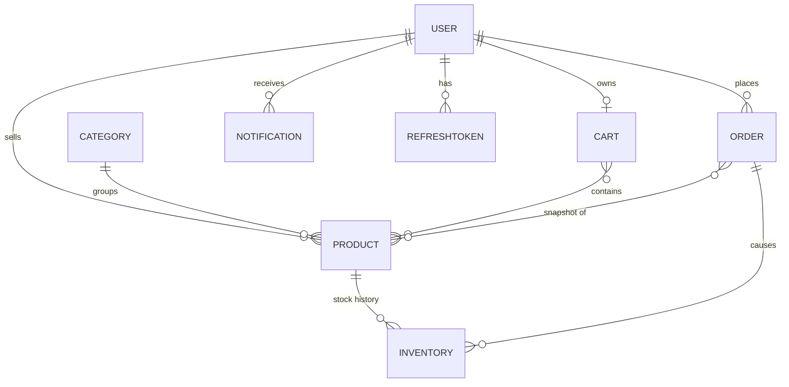

# ShopSphere - E-Commerce and Inventory Management System

A full-stack marketplace with **customers, sellers and an admin**, secure JWT authentication, atomic inventory control (no overselling), MongoDB aggregation reports and real-time notifications.

**Stack:** Node.js, Express.js, MongoDB, Mongoose, React (Vite), JWT access + refresh tokens, bcrypt, Socket.IO, EventEmitter, express-validator, Postman.

---

## 1. Problem statement
Small online shops often track stock manually. Two customers can buy the last item at the same moment (overselling), sellers learn about orders late, and owners have no sales insight. This project solves these problems with a secure multi-role platform that automatically updates stock, alerts sellers instantly and reports sales with database aggregation.

## 2. Objectives
1. Build a secure REST API using MVC architecture.
2. Provide role-based access for customer, seller and admin.
3. Prevent overselling using atomic MongoDB updates.
4. Keep a full inventory history and low-stock alerts.
5. Provide analytics with MongoDB aggregation pipelines.
6. Push real-time notifications with Socket.IO and EventEmitter.
7. Deliver a responsive React frontend.

## 3. Features
- Register/login, bcrypt hashing, JWT access token (15 min) + rotating refresh token (7 days, stored hashed), logout, rate-limited auth routes
- RBAC: customers cannot reach seller/admin APIs; sellers cannot modify other sellers' products
- Products: CRUD, search, category/price filters, sorting, pagination, images, seller info, stock
- Admin category management
- Private cart per customer, **all prices calculated on the backend**
- Orders: unique order number, price snapshots, address, status workflow with transition rules, **simulated payment** (clearly labelled)
- Inventory: automatic reduction, restore on cancel, history, low-stock alerts, seller-wise and admin views
- Analytics: sales, best sellers, category sales, monthly revenue, pending/completed orders, inventory summary
- Real-time: new-order, order-status and low-stock notifications without page refresh

## 4. System architecture


## 5. Database design

| Collection | Purpose | Key fields |
|---|---|---|
| User | accounts | name, email (unique), password (hash), role |
| Category | product groups | name (unique), slug |
| Product | items for sale | name, price, stock, category, seller, lowStockThreshold, isActive |
| Cart | one per customer | user (unique), items[product, quantity] |
| Order | purchases | orderNumber, customer, items[snapshot], totalAmount, status, shippingAddress, paymentStatus |
| Inventory | stock history (append-only) | product, type, quantityChange, stockBefore/After, order |
| Notification | real-time messages | user, type, message, isRead |
| RefreshToken | session control | user, tokenHash, expiresAt, revoked |

**Indexes and why**
1. `Product {category, price}` - fast category + price filter/sort on the product list.
2. `Product {seller, createdAt}` - seller dashboard lists.
3. `Order {customer, createdAt}` - "my orders, newest first".
4. `Order {items.seller, status}` - seller order lists and reports.
5. `Inventory {product, createdAt}` - stock history per product.
6. `RefreshToken {expiresAt}` TTL - MongoDB deletes expired tokens automatically.

**Aggregation pipelines** (`controllers/reportController.js`): (1) sales + status counts + monthly revenue using `$unwind/$group/$project/$sort`; (2) best sellers using `$group/$sort/$limit`; (3) category sales using two `$lookup` joins; (4) inventory summary using `$group` with `$cond`.

## 6. Folder structure
```
ecommerce-inventory/
├── README.md
├── backend/   config/ controllers/ models/ routes/ middleware/ services/ utils/
│              sockets/ events/ seeders/ tests/ app.js server.js package.json .env.example
└── frontend/  public/ src/{components,pages,context,services,hooks,assets} App.jsx main.jsx package.json
```

## 7. Installation (VS Code)
**Needs:** Node.js 18+ and MongoDB (local Community Server **or** free MongoDB Atlas).

### MongoDB setup
- **Local:** install MongoDB Community, make sure it is running, use `MONGO_URI=mongodb://127.0.0.1:27017/ecommerce_db`.
- **Atlas:** create a free cluster, add a database user, allow your IP, copy the connection string into `MONGO_URI`.

### Backend
```bash
cd backend
npm install
copy .env.example .env      # Windows   (Mac/Linux: cp .env.example .env)
# open .env and set MONGO_URI and two long random JWT secrets
npm run seed                # inserts demo data
npm run dev                 # http://localhost:5000
```
Generate secrets: `node -e "console.log(require('crypto').randomBytes(48).toString('hex'))"`

### Frontend (second terminal)
```bash
cd frontend
npm install
npm run dev                 # http://localhost:5173
```
Optional: copy `frontend/.env.example` to `.env` if your backend is not on port 5000.

### Environment variables (backend `.env`)
| Name | Meaning |
|---|---|
| PORT | API port (5000) |
| MONGO_URI | MongoDB connection string |
| JWT_ACCESS_SECRET / JWT_REFRESH_SECRET | secrets for signing tokens (different values) |
| ACCESS_TOKEN_EXPIRES | access token life (15m) |
| CLIENT_URL | allowed frontend origin for CORS and sockets |
| AUTH_RATE_LIMIT | max auth requests per 15 min per IP (30) |

`.env` is in `.gitignore`. **Never commit it.**

## 8. Demo credentials (created by `npm run seed`)
| Role | Email | Password |
|---|---|---|
| Admin | admin@shop.com | Admin@123 |
| Seller 1 | seller1@shop.com | Seller@123 |
| Seller 2 | seller2@shop.com | Seller@123 |
| Customers | customer1@shop.com, customer2@shop.com, customer3@shop.com | Customer@123 |

Seed data: 5 categories, 15 products (2 already low on stock), 7 sample orders over several months, inventory records.

## 9. API documentation
Base URL `http://localhost:5000/api`. Every response is `{ "success": true|false, "message": "...", "data": ... }`. Errors add `"errors":[{field,message}]` for validation.
Auth header: `Authorization: Bearer <accessToken>`.

| Method | Endpoint | Auth | Role | Success | Main errors |
|---|---|---|---|---|---|
| POST | /auth/register | No | - | 201 | 400 validation, 409 email exists |
| POST | /auth/login | No | - | 200 | 400, 401 wrong credentials |
| POST | /auth/refresh | No | - | 200 | 401 invalid/used token |
| POST | /auth/logout | No | - | 200 | 400 |
| GET | /auth/me | Yes | any | 200 | 401 |
| GET | /products | No | - | 200 | 400 bad filter |
| GET | /products/:id | No | - | 200 | 400 bad id, 404 |
| GET | /products/seller/mine | Yes | seller, admin | 200 | 401, 403 |
| POST | /products | Yes | seller, admin | 201 | 400, 401, 403 |
| PATCH | /products/:id | Yes | seller (own), admin | 200 | 400, 403, 404 |
| DELETE | /products/:id | Yes | seller (own), admin | 200 | 403, 404 |
| GET | /categories | No | - | 200 | - |
| POST | /categories | Yes | admin | 201 | 400, 403, 409 duplicate |
| PATCH | /categories/:id | Yes | admin | 200 | 403, 404 |
| DELETE | /categories/:id | Yes | admin | 200 | 404, 409 has products |
| GET | /cart | Yes | customer | 200 | 401, 403 |
| POST | /cart | Yes | customer | 201 | 400, 404, 409 not enough stock |
| PATCH | /cart/:productId | Yes | customer | 200 | 404, 409 |
| DELETE | /cart/:productId | Yes | customer | 200 | 400 |
| POST | /orders | Yes | customer | 201 | 400 empty cart/address, 409 stock |
| GET | /orders | Yes | any (scoped) | 200 | 401 |
| GET | /orders/:id | Yes | owner customer, involved seller, admin | 200 | 403, 404 |
| PATCH | /orders/:id/status | Yes | seller (involved), admin | 200 | 400 illegal transition, 403, 404 |
| POST | /orders/:id/cancel | Yes | owner customer, seller, admin | 200 | 400 not cancellable, 403 |
| GET | /inventory | Yes | seller, admin | 200 | 403 |
| GET | /inventory/low-stock | Yes | seller, admin | 200 | 403 |
| PATCH | /inventory/:productId | Yes | seller (own), admin | 200 | 400, 403, 404 |
| GET | /inventory/history/:productId | Yes | seller (own), admin | 200 | 403, 404 |
| GET | /reports/sales | Yes | seller, admin | 200 | 403 |
| GET | /reports/best-selling | Yes | seller, admin | 200 | 403 |
| GET | /reports/category-sales | Yes | seller, admin | 200 | 403 |
| GET | /reports/inventory | Yes | seller, admin | 200 | 403 |
| GET | /notifications | Yes | any | 200 | 401 |
| PATCH | /notifications/read-all, /:id/read | Yes | any | 200 | 404 |

Product list query: `?q=&category=&minPrice=&maxPrice=&sort=newest|oldest|price_asc|price_desc&page=1&limit=12`. Reports for a seller cover only that seller's items; admin sees all.

### Sample requests and responses
**POST /auth/register**
```json
{ "name": "Aarav Sharma", "email": "aarav@example.com", "password": "Secret@123", "role": "customer" }
```
201 → `{ "success": true, "message": "Registration successful", "data": { "user": {"id":"...","name":"Aarav Sharma","email":"aarav@example.com","role":"customer"}, "accessToken": "...", "refreshToken": "..." } }`
409 → `{ "success": false, "message": "Email is already registered" }`

**POST /products** (seller)
```json
{ "name": "Wireless Mouse", "description": "2.4GHz", "price": 799, "stock": 25, "category": "<categoryId>", "images": ["https://..."], "lowStockThreshold": 5 }
```
201 → product object. 403 for a customer: `{ "success": false, "message": "You do not have permission to perform this action" }`

**POST /cart** `{ "productId": "<id>", "quantity": 2 }` → 201 with items, `subtotal`, `total` calculated by the server. 409: `Only 3 unit(s) available in stock`.

**POST /orders**
```json
{ "shippingAddress": { "fullName": "Aarav Sharma", "phone": "9876543210", "line1": "12 MG Road", "city": "Gurugram", "state": "Haryana", "postalCode": "122001" } }
```
201 → order with `orderNumber`, item snapshots, `totalAmount`, `status: "Pending"`, `paymentStatus: "simulated_paid"`. No price is accepted from the client.

**PATCH /orders/:id/status** `{ "status": "Confirmed" }` → 200. Illegal jump → 400 `Cannot change status from Confirmed to Delivered`.

**Order status rules:** Pending→Confirmed/Cancelled, Confirmed→Processing/Cancelled, Processing→Shipped, Shipped→Delivered. Delivered and Cancelled are final. Cancelling restores stock.

## 10. Inventory safety (preventing overselling)
`inventoryService.reduceStock` runs one MongoDB command:
```js
Product.findOneAndUpdate({ _id, stock: { $gte: qty } }, { $inc: { stock: -qty } })
```
The stock check and the reduction are one atomic operation. If two customers buy the last unit, only one update matches; the other gets `null` and a 409 error. For multi-item orders, if a later item fails, items already reduced are put back (compensating rollback, recorded in Inventory as `rollback`). This works on a normal single MongoDB server (transactions would need a replica set).

## 11. Real-time functionality
- **EventEmitter** (`events/appEvents.js`) is the *internal* bus. Services emit `order:placed`, `order:status`, `stock:low` and know nothing about notifications.
- **Listeners** (`events/listeners.js`) save a Notification in MongoDB and call Socket.IO.
- **Socket.IO** (`sockets/socketServer.js`) is the *external* channel to browsers. The JWT is checked in the handshake. The server puts each user in a private room `user:<id>`; clients cannot join rooms, so nobody can listen to another user's notifications.
- Who is notified: seller on new order; customer on status change; seller + admins on low stock.

## 12. Security summary
bcrypt hashing · JWT access tokens · refresh-token rotation with hashed storage and reuse detection · RBAC middleware + ownership checks · express-validator · Helmet · CORS limited to the frontend origin · rate limit on auth · no stack traces or secrets in errors · secrets only in `.env`.

## 13. Postman testing
1. Run `npm run seed` and start the backend.
2. Import `backend/tests/postman_collection.json` (Postman → Import).
3. Open the **Collection Runner** and run all 32 requests **in order** (they save tokens and ids in collection variables).

It covers: register, login, invalid login, no token (401), customer calling seller API (403), add/update/delete product, add to cart, place order, stock reduced, insufficient stock (409), cancel + stock restored, another customer's order (403), status update + illegal transition, role check on status, all reports, low-stock alert + notification, refresh rotation and token reuse rejection.

Automated checks that need no database: `cd backend && npm test` (8 tests).

## 14. What has and has not been verified
- Verified in development: backend syntax and module loading, 8 automated tests (startup, validation errors, 401/404 handling, invalid ids, bad JSON), and the frontend production build.
- **Not yet run against a live MongoDB** (none was available when the project was generated): seeding, order flow, aggregation results and live notifications. Run the Postman collection once on your machine; if any request fails, send me the response and I will fix it.

## 15. Future enhancements
Real payment gateway · image upload (Cloudinary) · email notifications · product reviews · coupons · refresh token in httpOnly cookie · MongoDB transactions on a replica set · Docker deployment · automated integration tests.

---

## Screenshots checklist (for the report)
1. Landing page · 2. Register/Login · 3. Product list with filters and pagination · 4. Product details · 5. Cart · 6. Checkout (simulated payment box) · 7. Order history with status steps · 8. Seller product management · 9. Inventory page with low-stock banner and history · 10. Analytics dashboard · 11. Admin category page · 12. Notification bell + toast while a seller updates an order (two browsers) · 13. MongoDB Compass collections and indexes · 14. Postman Collection Runner all green · 15. Terminal showing `npm test` pass.

## Viva preparation (short answers)
- **Why JWT?** Stateless authentication; the server does not store sessions. Short-lived access token limits damage if stolen.
- **Why refresh tokens?** User stays logged in without a long-lived access token. Ours are rotated and stored hashed.
- **How do you prevent overselling?** One atomic `findOneAndUpdate` with `stock >= qty`, plus rollback for multi-item orders.
- **Why copy price into the order?** Price snapshot keeps old orders correct when prices change.
- **Why never trust frontend prices?** Users can edit requests; the server reads prices from the database.
- **EventEmitter vs Socket.IO?** EventEmitter is inside the server; Socket.IO connects server to browsers.
- **How are sockets secured?** JWT in the handshake, and server-controlled private rooms.
- **RBAC vs ownership?** RBAC checks the role; ownership checks that this seller owns this product/order.
- **Why bcrypt?** Slow, salted hashing; passwords cannot be read back.
- **Why indexes?** Avoid scanning the whole collection for common queries.
- **What is an aggregation pipeline?** A sequence of stages (`$match`, `$unwind`, `$group`...) that transforms documents into report results inside the database.
- **Why soft delete products?** Old orders and inventory history still reference them.
- **Why compensating rollback instead of transactions?** Transactions need a replica set; this works on a standard install.
